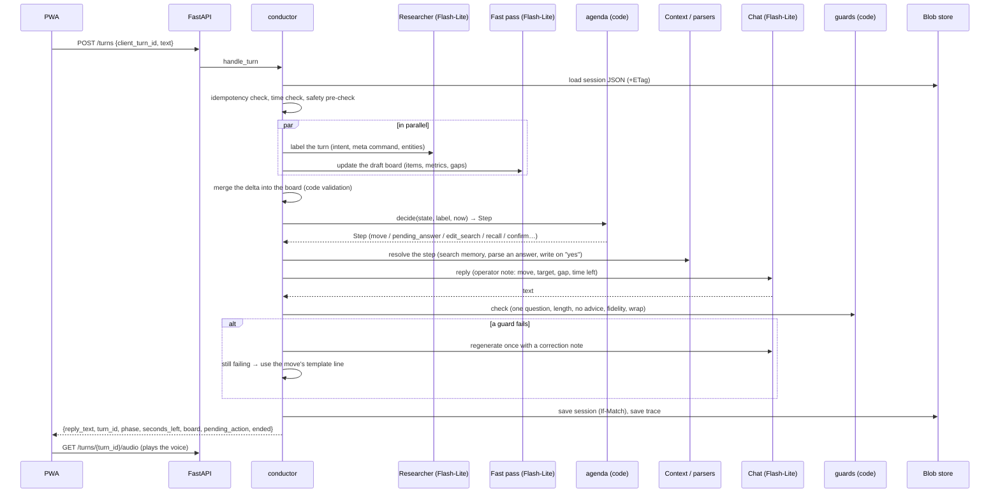

# Daybook

A voice-first work journal for software engineers. At the end of the day Daybook talks with you for a
few minutes, asks short follow-up questions, and turns what you said into a memory you can search:
achievements with resume bullets, the numbers behind them, things you learned, and questions to
close tomorrow ("you said the import got faster: by how much?").

- **You speak or type** (on iPhone, with the Wispr Flow keyboard); **Daybook answers out loud**
  (ElevenLabs, voice "Sarah"; Gemini TTS as the fallback).
- **Gemini does the language work**: understanding each turn, drafting items, writing bullets and
  answering questions. **Plain Python decides everything else**: what to ask next, when to wrap up,
  which numbers are allowed and how deltas are computed.
- **The memory is one SQLite file per user**, with full-text and vector search inside it, stored as
  a blob (a local folder in development, S3 in production).

This README explains how the code works at a low level: what runs on every turn, how memory is
stored and versioned, and where to change things. For the product spec read [plan.md](plan.md). For
current build state, read [docs/STATUS.md](docs/STATUS.md). The HTTP contract is in
[docs/API.md](docs/API.md), decisions in [docs/DECISIONS.md](docs/DECISIONS.md), and open questions
in [docs/REVIEW_QUEUE.md](docs/REVIEW_QUEUE.md).

---

## Contents

1. [Quick start](#1-quick-start)
2. [Repository layout](#2-repository-layout)
3. [The big picture](#3-the-big-picture)
4. [One turn, step by step](#4-one-turn-step-by-step)
5. [Sessions: modes, phases and the clock](#5-sessions-modes-phases-and-the-clock)
6. [The agents](#6-the-agents)
7. [The agenda: how the next question is chosen](#7-the-agenda-how-the-next-question-is-chosen)
8. [Guards and the safety path](#8-guards-and-the-safety-path)
9. [Finalize: from a conversation to saved memories](#9-finalize-from-a-conversation-to-saved-memories)
10. [The memory vault](#10-the-memory-vault)
11. [Numbers: how Daybook avoids invented metrics](#11-numbers-how-daybook-avoids-invented-metrics)
12. [Pending questions: closing the loop the next day](#12-pending-questions-closing-the-loop-the-next-day)
13. [Retrieval, Ask and fixing a memory by voice](#13-retrieval-ask-and-fixing-a-memory-by-voice)
14. [Voice](#14-voice)
15. [Background jobs, reminders and cleanup](#15-background-jobs-reminders-and-cleanup)
16. [Money: spend breaker and demo caps](#16-money-spend-breaker-and-demo-caps)
17. [Demo mode](#17-demo-mode)
18. [HTTP layer, auth and security](#18-http-layer-auth-and-security)
19. [Observability: traces, the session judge and Admin](#19-observability-traces-the-session-judge-and-admin)
20. [The frontend (PWA)](#20-the-frontend-pwa)
21. [Storage layout](#21-storage-layout)
22. [Configuration](#22-configuration)
23. [Fake mode, tests, evals and CI](#23-fake-mode-tests-evals-and-ci)
24. [Deployment target (planned, not built yet)](#24-deployment-target-planned-not-built-yet)
25. [Invariants worth protecting](#25-invariants-worth-protecting)
26. [Where to change what](#26-where-to-change-what)

---

## 1. Quick start

```bash
make install        # uv sync (Python 3.12) + npm install
make test           # 25 offline tests, about 3 s
make dev            # API on :8300 with fake LLM/voice + Vite on :5173 → open http://localhost:5173
make dev-live       # the same with real Gemini + ElevenLabs voice (needs GEMINI_API_KEY, ELEVENLABS_API_KEY in .env)
make chat-live      # a full reflection in the terminal, no browser
make eval           # eval suites in fake mode (free; checks the plumbing only)
make seed           # rebuild data/seed/demo-memory.db from data/seed/demo-persona.json
make owner-key      # create your sign-in key (printed once; only its hash goes into .env)
```

Click **Try the demo** on the landing page to get a sandbox with two made-up weeks of reflections.
To test "tomorrow" without waiting, set `localStorage["daybook.debugNow"]` in the browser, or send an
`X-Debug-Now` header. Both work only locally and in demo sandboxes.

The `.env` file in the repo root is git-ignored. It holds `GEMINI_API_KEY`, `GEMINI_TTS_API_KEY`,
and later `ELEVENLABS_API_KEY`, `ELEVEN_VOICE_ID`, `OWNER_KEY_HASH`, `SESSION_SIGNING_KEY`, and the
VAPID keys.

---

## 2. Repository layout

```text
backend/
  pyproject.toml, uv.lock     Python 3.12 project (uv)
  schema.sql                  the vault schema (one SQLite file per user)
  daybook/
    main.py                   FastAPI app, middleware, error envelope, local ticker, Lambda handler
    settings.py               every setting, read from env / root .env (pydantic-settings)
    worker.py                 background jobs: finalize, session judge, reminders, cleanup
    api/                      HTTP routers: auth, sessions, memories, settings_api, admin; deps.py
    engine/                   the deterministic core
      app.py                  App container: store, vaults, LLM, embedder, TTS, budgets, dispatch()
      conductor.py            one turn end to end; start/end session; edit + recall flows
      agenda.py               rules that pick the next move (question) from the session state
      phases.py               the time budget: close-loops cap, wrap window, grace
      guards.py               code checks on every reply (one question, length, advice, numbers)
      safety.py               crisis phrases → fixed helpline message, no LLM
      state.py                SessionState (the short-term memory) and its JSON load/save
      finalize.py             deep pass → validation → versioned vault write
      budget.py               SpendBreaker (daily $), DemoCaps (sessions/asks per sandbox/day)
      demo.py                 demo sandbox: copy seed, shift dates, suggestions, replay
    agents/                   the LLM-backed steps, one module each (+ schemas.py, base.py)
    prompts/*.md              versioned prompts (front-matter `version:`), rendered by prompts/__init__.py
    llm/gemini.py             google-genai wrapper: generate (structured JSON), embed, TTS
    llm/fakes.py              offline stand-ins: scripted FakeLLM (tests), HeuristicFakeLLM (make dev)
    memory/                   vault + data access
      db.py                   connect: load sqlite-vec, apply schema, create docs_vec
      vault.py                the SQLite-in-a-blob protocol (read cache, If-Match writes, retries)
      repo.py                 all SQL: items + versions, metrics, pending, sessions, digests, docs
      validate.py             quote/number checks, delta arithmetic, bullet rules
      embed.py                Gemini and fake embedders, vector (de)serialisation
      retrieval.py            hybrid search (vectors + BM25 + RRF + date boost) and indexing
      export.py               Resume-as-code JSON and Markdown export
    storage/blob.py           BlobStore protocol: LocalBlobStore (dev) and S3BlobStore (prod)
    voice/                    TTS providers, speech text normalisation, WAV helpers
    push/                     Web Push sender (VAPID) and the reminder tick
    obs/                      traces/spans, cost table (pricing.yaml), structured logs
  scripts/                    seed_demo.py, chat.py, owner_key.py, gen_vapid.py
  tests/                      pytest: memory, engine, api, worker
frontend/                     Vite + React 19 + TypeScript PWA (vite-plugin-pwa, injectManifest)
  src/api.ts, types.ts        typed client for docs/API.md
  src/audio.ts                one reused <audio> element, iOS unlock, playback states
  src/sw.ts                   service worker: app shell cache + push notifications
  src/screens/                Landing/Today, Reflect, Summary, Timeline, ItemDetail, Ask, Remind, Settings, admin/
evals/                        run.py (suites) + data/*.jsonl inputs; results/ (git-ignored)
data/seed/                    demo-persona.json (source) + demo-memory.db (built, committed)
docs/                         STATUS, API, DECISIONS, REVIEW_QUEUE, VOICE_PROMPTS
infra/                        IAM deployer policy only (no stack yet)
```

---

## 3. The big picture

```text
 ┌──────────── PWA (React) ────────────┐
 │ Today · Reflect · Timeline · Ask ·  │  text in (typed or Wispr), audio out
 │ Remind me · Settings · Admin        │
 └───────────────┬─────────────────────┘
                 │  /api/*  (cookie + X-Requested-With)
 ┌───────────────▼──────────────────────────────────────────────────────────────┐
 │ FastAPI (backend/daybook/main.py)                                            │
 │                                                                              │
 │   POST /sessions/{id}/turns ─► conductor.handle_turn                         │
 │      Researcher ∥ fast pass ─► merge board ─► agenda.decide ─► (Context /     │
 │      pending answer / confirmed write) ─► Chat ─► guards ─► reply text       │
 │                                                                              │
 │   GET /turns/{id}/audio ─► TTS (cached by text hash)                         │
 │   POST /sessions/{id}/end ─► dispatch("finalize_session")                    │
 └───────┬──────────────────────────────┬────────────────────────┬──────────────┘
         │                              │                        │
  short-term memory              long-term memory           traces + counters
  sessions/{id}.json             memory.db (SQLite:         traces/…/{seq}.json
  (rewritten every turn,         items, versions, metrics,  spend/{day}.json
   If-Match on ETag)             pending, FTS5, vectors)    demo-caps/{day}.json
         │                              ▲
         │      worker (async job)      │
         └──► finalize: deep pass ─► validate in code ─► versioned write ─► embed
              then: session judge (scores the conversation)
```

The design follows a few rules:

- **The orchestrator is code, not an LLM.** `conductor.py` runs the steps in a fixed order, and
  `agenda.py` picks the next question from the session state and the clock. The LLM never decides
  which agent runs next.
- **Two memories.**
  - **Short-term:** the session file, which holds every turn, the live draft "board" of items, the
    gaps, and the pending-question queue. It is rewritten each turn.
  - **Long-term:** the vault, the user's SQLite file. During a session it is written only when you
    confirm something (a number, a fix). Otherwise it is written once, at finalize.
- **Everything external sits behind a small interface,** so the whole app runs offline:
  - the blob store (local folder or S3)
  - the LLM (Gemini or a fake)
  - the embedder (Gemini or a fake)
  - TTS (ElevenLabs, Gemini or fake)
  - the push sender (VAPID or fake)
- **The same code runs in both places.** On a laptop, background jobs run as asyncio tasks inside
  the API process. On AWS they will run in a second Lambda function.

---

## 4. One turn, step by step

Entry point: `POST /api/sessions/{sid}/turns` with `{client_turn_id, text, dictated_chars}` →
`api/sessions.py` → `conductor.handle_turn()`.



In detail, `handle_turn` does the following:

1. **Load and protect.** It loads `sessions/{sid}.json` together with its ETag.
   - If `client_turn_id` was seen before, it returns the stored result. Retries from a flaky
     network are safe.
   - If the session has ended, it returns `409 session_ended`.
   - If the clock is past the limit plus 15 s of grace, it ends the session and returns
     `409 time_up`.
2. **`_run_turn`.** This appends the user turn (capped at 4,000 characters), then:
   1. **Safety pre-check** (`safety.is_crisis`, plain regex). On a match, the turn returns the
      fixed helpline message, makes no LLM call, and the user's text is not saved in the trace.
   2. **Researcher and fast pass run in parallel** (`asyncio.gather`):
      - **Researcher** returns a `TurnLabel`: `primary_intent` (reflect, metric_answer, defer,
        not_quantifiable, edit_request, confirm, deny, recall_request, support_request, vent, meta,
        off_topic, crisis_signal), `meta_command` (wrap_up, stop, pause, repeat, skip, time_left),
        `injection_suspected`, and entities (project, time references, a target hint).
      - **Fast pass** returns a `DraftDelta`: new or updated board items, raw metrics and gaps
        (missing number, outcome, ownership…).
   3. If the Researcher says `crisis_signal`, the turn takes the safety path, and the stored text
      becomes "(not saved)".
   4. **Merge** (`_merge_delta`). The delta is applied only when it fits the turn
      (`_delta_applies`). For example, a plain "yes" to a confirmation adds no items. Every merged
      metric is checked against the user's words before it is shown.
   5. **Decide** (`agenda.decide`). Pure code: it returns a `Step` (see §7).
   6. **Resolve** (`_resolve`). Steps that need more than a template are handled here:
      - answering a pending question
      - confirm or deny
      - searching for the record you want to change, and picking between candidates
      - describing the edit
      - recall ("what did I do on search last week?")

      This is the only point where the vault is written during a session, and only after an
      explicit "yes" (DB-10).
   7. **Speak** (`speak`). The Chat agent gets the conversation plus an operator note built from
      the move (`Move.note()`): what to do, which item, which gap, and the seconds left. Its reply
      runs through the guards. If any guard fails, the reply is regenerated once with a correction
      note. If it fails again, the move's template line is used instead, so a reply never ships
      unchecked. Moves with `use_llm=False` skip the LLM entirely. These include confirmations,
      read-backs and goodbyes.
   8. **Account and trace.** It adds tokens and cost to the session budget and to the daily spend
      breaker. It also writes one trace file for the turn, with spans for each agent and code step.
3. **Save.** The session is written with `If-Match` on the old ETag. If another tab wrote first
   (`412`), the turn is reloaded and replayed, up to 3 times. This is safe because turns are
   idempotent on `client_turn_id`.
4. **Finish.** If the move ended the session, `_finish` marks it ended, clears the active-session
   pointer and dispatches `finalize_session`.

The response carries `reply_text`, `turn_id`, `phase`, `seconds_left`, the board (item chips such as
"needs number" or "number captured"), a `pending_action` the UI shows as a prompt, suggestion chips
(demo only) and `ended`.

---

## 5. Sessions: modes, phases and the clock

`engine/phases.py` and `engine/state.py`.

| Mode | Phases | What it's for |
|---|---|---|
| `guided` | open → close_loops → explore → wrap → done | The daily reflection. |
| `dump` | dump → followups (≤ 3) → wrap → done | "Let me just talk": one monologue, then a few follow-ups. |
| `quick` | capture → done | One-line log. |
| `edit` | edit → done | Fix one memory by voice, opened from the Timeline. |

The server's clock is the only one that counts. The client shows `seconds_left` from the server.

- **Limit:** 420 s for the owner (configurable in Settings), 180 s in the demo.
- **close_loops:** at most 21% of the limit (between 30 and 90 s) and at most 3 pending questions.
  It is skipped when nothing is pending.
- **wrap:** starts in the last 14% of the limit (at least 25 s), or when you say "let's wrap up".
- **Grace:** a turn arriving more than 15 s after the limit gets `409 time_up`, and the session is
  ended with reason `time_limit`.
- **Follow-ups:** at most 2 per item, and at most 3 after a brain dump.

`SessionState` (the short-term memory) holds:

- the turns (with intent, move and dictated characters)
- `board_items` and `gaps`
- `pending_queue`, `current_pending` and `asked_pending`
- `pending_action` (what the UI is waiting on: `confirm_metric`, `confirm_edit`, `pick_item`,
  `describe_edit`…)
- `followups`, `flags`, `budgets` and `guard_fails`
- `prompt_versions`, `turn_latencies` and `client_turns` (the idempotency map)
- later, `finalize_result` and `summary`

It is a dataclass serialised to JSON at `{prefix}sessions/{sid}.json`.

Starting a session (`start_session`) does the following:

- It refuses a second active session (`409 session_active`) unless the old one is past grace.
- It loads open pending questions (guided mode only), the projects, the last plan item and your
  preferences.
- It builds the opener (`agenda.opener`):
  - if something is pending, it asks it ("Last time you mentioned…")
  - otherwise, if yesterday had a plan, it asks about the plan
  - otherwise, it asks a plain "How did today go?"

---

## 6. The agents

Each agent is a small module in `agents/` that renders a versioned prompt from `prompts/` and calls
`base.structured()`. That function asks Gemini for JSON matching a Pydantic schema
(`agents/schemas.py`) and validates the result. Any change to a prompt bumps its `version:`, and the
version is recorded on the trace span.

| Agent | Module · prompt | Model · thinking | When | Output |
|---|---|---|---|---|
| Researcher | `researcher.py` · `researcher.md` | 3.5 Flash-Lite · minimal | every turn | `TurnLabel`: intent, meta command, injection flag, entities |
| Fast pass | `analyzer_fast.fast_pass` · `analyzer_fast.md` | 3.5 Flash-Lite · minimal | every turn (not in edit mode) | `DraftDelta`: board items, raw metrics, gaps |
| Pending-answer parser | `analyzer_fast.parse_pending_answer` · `pending_answer.md` | Flash-Lite · minimal | when you answer a pending question with a number | `PendingAnswer` candidate + read-back |
| Edit patch | `analyzer_fast.propose_edit` · `edit_patch.md` | Flash-Lite · minimal | fixing a memory | `EditPatch` (field changes, metric changes) |
| Context agent | `context.py` · `context_verify.md` | hybrid search + Flash-Lite verifier | edit requests (recall skips the verifier, DB-15) | `ContextResult`: found / ambiguous / none + candidates |
| Chat | `chat.py` · `chat.md` | 3.5 Flash-Lite · minimal | every LLM move | one short spoken line |
| Deep pass | `finalize._deep_pass` · `analyzer_deep.md` | 3.8 Flash · low | once, at finalize | `FinalizeResult`: items, bullets, metrics, links, pending, day summary |
| Ask | `ask.py` · `ask.md` | 3.8 Flash · low | Ask screen | `AskAnswer`: sentences with citations, or abstain |
| Session judge | `judge.py` · `judge_session.md` | Flash-Lite · minimal | after finalize | `JudgeScores` per rubric line |

`llm/gemini.py` wraps `google-genai`:

- It sets `thinking_level` per call (DB-04) and the JSON response schema.
- It retries transient errors.
- It returns an `LLMResponse` with the text, the parsed object, token counts, `finish_reason`,
  `blocked`, `latency_ms` and a cost computed from `obs/pricing.yaml`.

Fake responses carry `free=True`, so they never count towards spend.

---

## 7. The agenda: how the next question is chosen

`agenda.decide(state, label, now)` is a chain of rules. The first match wins:

1. **A pending action is open** (Daybook asked "So that's from 40 to 6 a week?"):
   - confirm → `confirm`
   - deny → `deny`
   - a restated number → `pending_answer`
   - "no, the other one" → `pick`
   - otherwise, the step that action expects (`describe_edit`, `find_again`)
2. **crisis_signal** → `safety`.
3. **support_request or vent** → an empathetic move, with no probing for numbers.
4. **Meta commands:**
   - stop → goodbye
   - wrap_up → the wrap move, or a goodbye if already wrapping
   - repeat → the last line again
   - time_left → seconds left
   - pause → a short pause line
   - skip → the next move
5. **edit_request** → `edit_search`. **recall_request** → `recall_search`.
6. **A pending question is being asked** → `pending_answer`.
7. **off_topic or a suspected prompt injection** → a polite redirect back to the day.
8. **In the wrap phase** → goodbye (it says so if something was added during the wrap).
9. Otherwise, `next_move`:
   - over the limit → goodbye
   - wrap due → wrap
   - still in close_loops with time and questions left → ask the next pending question
   - in dump mode → follow-ups
   - else, the most useful open **gap**, with numbers first for achievements and never a number
     for soft skills
   - else, an open question ("What else happened today?")

A `Move` carries everything the Chat agent and the guards need:

- `name`
- `template` (the fallback line)
- `target` and `gap`
- `say_back` (facts it may repeat)
- `max_words`
- `use_llm`
- `wrap`, `promised` (the questions it promised to ask next time) and `end`

`noun_phrase()` turns an item title into speakable text, so "Shipped the faster import" becomes "the
faster import".

---

## 8. Guards and the safety path

`engine/guards.py` checks every Chat reply in code, which takes about 0 ms:

| Guard | Rule |
|---|---|
| `one_question` | at most one `?` |
| `length` | at most `move.max_words` words |
| `no_advice` | none of "you should", "try to", "have you considered"…, unless you asked for advice |
| `fidelity` | every number in the reply appears in your words, the move's say-back, or its template |
| `phase` (wrap only) | names each promised question by its own words, says it will come back to them ("tomorrow", "next time"…), and says it may have missed things |

Markdown is stripped from replies, not failed. Failures are counted per session (`guard_fails`), and
`fidelity` failures are also logged.

`engine/safety.py` matches crisis phrases (English and Hinglish). The response is a fixed message
with the Tele-MANAS helpline (`tel:14416`), shown as a card in the UI. The reply is spoken even if
voice is off or the budget is spent. No LLM is involved, and the user's text is not stored in the
trace.

---

## 9. Finalize: from a conversation to saved memories

`engine/finalize.py`, run as the `finalize_session` job when a session ends.

1. **Idempotent start.** A session that is already finalized, or still active, is skipped.
   - If the owner is over the daily budget, the job is queued (`finalize_queued`) and retried by
     the cleanup job.
2. **Deep pass**, one `gemini-3.8-flash` call:
   - **Input:** the whole conversation, the board, and similar existing items (found by
     retrieval, so an update can merge into an existing record instead of duplicating it).
   - **Output:** items (new, update or merge_into), XYZ bullets, metrics, skills, links, new pending
     questions, pending questions the talk resolved, the day summary, energy and a mood word.
   - **Saved before any vault write,** so a retry never pays for the LLM twice. If the call fails,
     `fallback_result` builds a plain result from the board.
3. **Validation in code** (`_validate`). Nothing from the deep pass is trusted as-is:
   - **Source quote** must be found in your words. If it isn't, the item is kept as a **draft**
     with a note; it is never dropped silently.
   - **Metrics:** `source_text` must be your words, and every baseline, final and percentage must
     be supported by your words (`number_supported`). Failures are dropped, with a note.
   - **Soft-skill items carry no metrics** (DB-18).
   - **Bullets** exist only on achievements and soft skills, are 30–220 characters, and may contain
     only numbers you said.
   - **Dates** are clamped to the session day.
4. **Write** (`_write`, inside `vault.write`):
   - items are created or updated with a new version row
   - metrics are de-duplicated by their numbers (`metric_key`, DB-17)
   - deltas are computed by code
   - links are added
   - pending questions are created, plus any question the wrap promised that the deep pass missed
   - items with an open metric or outcome question stay **drafts** until it's answered
   - pending questions resolved during the talk are closed
   - `times_asked` goes up for questions asked today, and a question expires after 3 asks
   - the day digest is written (several sessions on one day are joined)
5. **Index.** Changed items and digests are re-embedded (`retrieval.index`). If that fails, the
   items are still saved, and indexing retries next time.
6. **Summary.** `state.summary` drives the Summary screen. The session row gets its stats
   (duration, turns, spoken %, cost). Then `session_judge` is dispatched.

---

## 10. The memory vault

### 10.1 One SQLite file in a blob (`memory/vault.py`, `storage/blob.py`)

- **Read:** `Vault.read()` keeps a local cached copy and the ETag it came from, and downloads again
  only when the blob's ETag changes.
- **Write:** `Vault.write(fn)` does the following:
  1. takes a fresh copy of the file
  2. runs `BEGIN`, then `fn(conn)`, then `COMMIT`
  3. uploads with `If-Match: <old ETag>`
  4. on `412` (someone else wrote first), downloads again and re-runs `fn`, up to 3 tries

  So `fn` must be safe to re-run, and network calls (LLM, embeddings) must happen before
  `write()`, never inside it.
- **Two stores, one contract.** `LocalBlobStore` gives the same guarantees on disk (md5 ETags, a
  lock, atomic replace). `S3BlobStore` uses S3 conditional writes (`IfMatch`, `IfNoneMatch`).
- **`VaultRegistry`** keeps up to 20 open vaults (an LRU), keyed by blob key: `users/owner/memory.db`
  or `demo/<sandbox>/memory.db`.

### 10.2 Schema (`backend/schema.sql`)

| Table | Holds |
|---|---|
| `profile`, `settings` | display name, org, role, timezone; app settings as JSON (reminder time, voice, session length, `keep_names`…) |
| `projects`, `skills` | names with aliases (case-insensitive unique) |
| `sessions`, `turns` | every finalized conversation and its turns |
| `memory_items` | the records: `kind` (achievement, progress, learning, challenge, soft_skill, decision, blocker, praise, plan), `status` (draft, active, hidden, merged), title/what/how/result, `bullet`, `ownership` (led, did, helped, team), `quantifiable`, scope, impact 1–5, `source_quote`, `occurred_on`, project |
| `memory_item_versions` | a full JSON snapshot per change, with `changed_by` (analyzer, user_voice, user_edit, restore) and a reason; restore makes a new version |
| `metrics` | name, category, unit, baseline, final, delta_abs, delta_pct (signed), better_when, period, approx, `source_text`, `is_derived` |
| `item_skills`, `item_links` | skills per item; links between items (continues, same_as, caused, blocked_by) |
| `pending_questions` | the next-day questions (see §12) |
| `digests` | day/week/month summaries with their item ids |
| `docs`, `docs_fts`, `docs_vec` | the search index: one doc per item and per digest, FTS5 (kept in sync by triggers) and a sqlite-vec `vec0` table (created in `db.py` only when the extension loads, DB-06) |
| `push_subscriptions` | Web Push endpoints |

`repo.py` holds all the SQL. Every item change goes through `create_item` / `update_item`, which
write a version snapshot, so the Timeline can show history and restore any version.

---

## 11. Numbers: how Daybook avoids invented metrics

This is the core promise. A resume bullet with a made-up number is worse than no bullet.

- **The LLM extracts; code checks.**
  - `validate.numbers_in()` reads numbers the way people say them: "1,200", "about 2 million",
    "18k", "4x", "50%".
  - `number_supported()` checks a value against your turns.
  - `numbers_unsupported()` lists numbers in a reply or bullet that you never said.
- **Code does the arithmetic.** `compute_deltas()` turns baseline and final into `delta_abs` and a
  signed `delta_pct`:
  - "Dropped 35%" is stored as −35.
  - "4x" means baseline 1.
  - A percentage alone stays a percentage.
  - Derived values are marked `is_derived`.
- **Nothing is saved without a yes.** During a session, a number you give for a pending question is
  read back ("So that's from about 40 a week to around 6?"). It is written only after you confirm
  (DB-16).
- **Every reply is checked.** The `fidelity` guard stops the Chat agent from saying a number you
  didn't.

---

## 12. Pending questions: closing the loop the next day

A pending question is tied to an item and has a `kind`: metric, outcome, ownership, date or
clarify.

```text
created (deep pass, or a promise in the wrap) ── open
   │  asked at the start of a later guided session (≤ 3 per session, newest first)
   ├─ you give a number  → parser → read-back → "yes" → metric written, status answered
   ├─ "not sure, ask me later"     → stays open (snoozed), asked again another day
   ├─ "can't really measure that"  → not_quantifiable
   ├─ dismissed from the Today screen → dismissed
   └─ asked 3 times without an answer → expired
```

Today and Remind me also let you answer by typing, using `/api/pending/{id}/answer` then
`/confirm`. That goes through the same parser and confirmation. An item whose metric or outcome
question is open stays a **draft** until the question is answered.

---

## 13. Retrieval, Ask and fixing a memory by voice

### 13.1 Hybrid search (`memory/retrieval.py`)

1. **Vector search:** the query embedding (`gemini-embedding-2`, 768-d, query task type) against
   `docs`. It uses sqlite-vec when loaded and in sync, otherwise numpy brute force.
2. **Keyword search:** FTS5 BM25 on the same docs (stop words removed).
3. **Fusion:** Reciprocal Rank Fusion with k = 60. A date window from the Researcher ("last
   Tuesday", "the week of the 12th") boosts matching docs, or filters to them when the date is
   explicit.
4. **Abstain signal:** the result carries `best_cosine` and `keyword_hits`. Callers abstain when the
   best cosine is under `abstain_cosine` (0.35) and nothing matched by keyword.

`index()` embeds new or changed docs (by content hash) in a batch, then writes them in one vault
transaction.

### 13.2 Ask (`agents/ask.py`)

1. Search, then send the top records to Flash with low thinking.
2. Every sentence in the answer must cite a retrieved item id; uncited sentences are dropped.
3. A number that doesn't appear in its cited records replaces the whole answer with the abstain
   message.
4. Weak retrieval abstains before any LLM call.

"When did I present to the CFO?" correctly comes back as "I don't have that in your memory."

### 13.3 Fixing a memory by voice

There are two ways in:

- say "Actually, the import last Tuesday was 40% faster, not 50" during a reflection, or
- tap **Fix by voice** on an item.

The flow:

1. **Find:** `context.find` runs a hybrid search, and a Flash-Lite verifier returns found,
   ambiguous or none.
2. **Read back:** Daybook asks "On Tuesday the 20th you said the import got about 50% faster.
   That one?" For an ambiguous match, it offers a short pick list.
3. **Propose:** the edit-patch agent writes the change. Code checks every number in it against
   what you just said.
4. **Confirm:** "Change 50% to 40%?" Only a "yes" writes a new version, with
   `changed_by = user_voice`.

---

## 14. Voice

- **Text first.** The reply text comes back with the turn, and the client then fetches
  `GET /api/turns/{turn_id}/audio`.
- **The audio endpoint:**
  - returns `204` when voice is off, the spend breaker isn't `ok`, or the session's TTS character
    budget (3,000; 1,000 in the demo) would be exceeded
  - returns `503` on a TTS error, and voice turns off after 2 failures
  - always speaks safety replies
- **Providers** (`voice/tts.py`, picked by `DAYBOOK_TTS`):
  - `elevenlabs`: `eleven_flash_v2_5`, voice Sarah (`EXAVITQu4vr4xnSDxMaL`), MP3. The live default (DB-26).
  - `gemini`: `gemini-3.8-flash-lite-tts`, voice Sulafat, 24 kHz WAV. The current default.
  - `fake`: a short silent WAV.
- **Cache:** audio is cached in the blob store under `tts-cache/{sha}.wav|mp3`, keyed by provider,
  voice and text, so repeated lines (templates, goodbyes) cost nothing.
- **Speech text:** `voice/normalize.py` rewrites text for speech ("p99" becomes "p ninety-nine",
  "%" becomes "percent", and dates and ranges are spelled out) without changing the displayed text.

---

## 15. Background jobs, reminders and cleanup

`App.dispatch(job, **payload)` runs a job as an asyncio task locally (`App.drain()` waits for them in
tests). On AWS it will invoke the worker Lambda asynchronously. Jobs live in `worker.run_job`:

| Job | Does |
|---|---|
| `finalize_session` | §9 |
| `session_judge` | scores the finished conversation (asked one question at a time, no advice, numbers right, wrap named the open questions…) and stores the scores on the session; Admin flags low scores |
| `reminder_tick` | every minute locally for every account; on AWS each account's own two EventBridge schedules fire at its exact times and name the account (`push/schedules.py`, DB-29): for each reminder day, a first nudge at your time and an optional second nudge; skipped if you already reflected; logged per day so a nudge is sent once; endpoints answering `410 Gone` are deleted. Body: "How did today go? 2 numbers to confirm from yesterday." |
| `cleanup_stale_sessions` | ends sessions that were hidden for over 120 s with no newer turn, or are over limit + 15 min; retries queued or failed finalizes |

**About the `idle` signal (DB-13).** `pagehide` sends `end` with reason `idle` through
`navigator.sendBeacon`. This is a soft signal: the server only marks `hidden_at`, and cleanup ends
the session later. A reload, or a switch to the Wispr keyboard on iPhone, doesn't cut the
reflection short.

---

## 16. Money: spend breaker and demo caps

`engine/budget.py`. Counters are small JSON blobs keyed by the IST day.

- **`SpendBreaker`** has a $2.00 daily budget, of which the demo may use at most $1.40 and all
  `user` accounts together $1.00, with $0.30 a day for any one of them (DB-29), so strangers can't
  use up the owner's budget. `status(user)` returns:
  - `ok`
  - `demo_replay` for demo users over budget
  - `over` for an account, which turns voice off and queues finalize; a `user` over its cap can't
    start a new session (429 `budget`)
- **`DemoCaps`:** each sandbox gets 2 sessions and 10 Ask questions. Across all sandboxes the daily
  limit is 15 sessions and 30 asks. Past a cap, the demo shows **replay mode**, a recorded session.
- **Per session:** caps on turns, input tokens and TTS characters.

Cost per call comes from `obs/pricing.yaml`. Prices were last checked on 2026-10-29; the Gemini prices double on 2027-01-01.

---

## 17. Demo mode

`engine/demo.py`.

- **The seed.** `data/seed/demo-persona.json` is two made-up work weeks for "Ayan, Software
  Engineer at Kestrel Travel": help-centre search, an AI trip assistant tested with the ML team, a
  nightly article import that got faster, an incident and its write-up, a demo page, mentoring a
  new junior, and covering for the lead.
  - It is written in plain words, so anyone watching the demo can follow it.
  - It is fictional: no real employer, project or number.
  - It contains everything the demo needs:
    - 2 open pending questions from "yesterday"
    - a Tuesday item that is "about 50% faster", to fix to 40% by voice
    - drafts, praise, a blocker that got resolved
    - nothing about a CFO, so Ask can show that it abstains
- **Building it.** `make seed` builds `data/seed/demo-memory.db` from the seed, with no LLM. It
  embeds the docs with `gemini-embedding-2` when `DAYBOOK_EMBED=gemini`, and the built file is
  committed.
- **`POST /api/demo/start`** creates a sandbox:
  1. copies the seed db
  2. shifts every date so the last reflection was **yesterday**, updating rows in an order that
     never breaks a unique date
  3. re-embeds if the app's embedder differs from the seed's
  4. uploads it to `demo/<id>/memory.db` and sets a 24-hour demo cookie
- **Suggestion chips** under the composer give judges a one-tap path through every feature.
- **Replay** (`data/seed/replay.json`) is played when caps or the budget are hit. It isn't recorded
  yet (RQ-07).

---

## 18. HTTP layer, auth and security

`main.py` and `api/deps.py`. The full contract is in [docs/API.md](docs/API.md).

- **Errors** always come back as `{"error": {"code", "message", ...}}`, including validation and
  unhandled errors.
- **Accounts (DB-29).** Three roles: `owner` (Ayan: his vault `users/owner/` and the Admin pages),
  `user` (anyone else who signs in with Google: a private vault `users/<uid>/`) and `demo`.
  - **Google sign-in is also sign-up.** The landing page shows Google's button (Identity Services,
    `components/GoogleButton.tsx`); it returns an ID token, and `POST /api/auth/google` checks it
    with `google-auth` (Google's keys, audience = `GOOGLE_CLIENT_ID`, expiry, issuer) and requires a
    verified email (`engine/accounts.py`). An email in `OWNER_EMAILS` maps to the owner. Anyone
    else gets uid `g` + 24 hex of sha256(`google:<sub>`), so no Google id appears in a key, and an
    `accounts/<uid>.json` record (email, name). `ALLOWED_EMAILS` (empty = anyone) and
    `MAX_ACCOUNTS` (25) limit sign-ups.
  - **Owner key** (a backup way in): a long random key, stored only as a hash (`make owner-key`),
    compared in constant time.
  - Logins are rate limited to 5 per minute. The session is a signed cookie `db_session`
    (itsdangerous; `HttpOnly`, `Secure`, `SameSite=Strict`) holding the role, uid and email, valid
    180 days for accounts and 24 hours for a demo.
- **CSRF:** every mutating request needs `X-Requested-With: daybook`. The one exception is
  `POST /sessions/{id}/end`, because `sendBeacon` can't set headers (DB-11).
- **Origin lock:** when `ORIGIN_VERIFY` is set, requests must carry the secret `X-Origin-Verify`
  header that CloudFront adds. This stops anyone calling the Lambda URL directly.
- **Rate limits:** token buckets, 120 requests a minute with a burst of 40.
- **Roles:** `account_only` (owner or user) guards push, exports and data delete; `owner_only`
  guards Admin. Every request reads and writes only the signed-in user's own prefix, so no account
  (or demo) can reach another's data. Deleting data as a `user` also removes the account record and
  its reminder schedules.
- **Time travel:** `X-Debug-Now` works only locally and for demo users.
- **Prompt injection:** the Researcher flags it, the agenda redirects, the guards still run, and
  the user's text can never trigger a write without the confirm flow.

---

## 19. Observability: traces, the session judge and Admin

- **Traces** (`obs/tracer.py`):
  - one JSON file per turn (`traces/{uid}/{date}/{sid}/{seq}.json`) and per job
  - spans for every agent and code step, with `gen_ai.*` attributes (model, tokens, latency) and
    `daybook.*` attributes (move, phase, guard results, prompt version, cost)
  - the crisis path stores no user text
- **Logs** (`obs/log.py`): one JSON line per event, such as `guard_fidelity_fail`,
  `session_conflict`, `tts_failed` or `finalize_failed`.
- **Admin** (owner only): an overview of today's spend, sessions, latency p50/p95, guard failure
  counts and judge flags; each session's turns with their spans; and eval results.
- **"How it decided":** in the demo, a panel on the Reflect screen shows the last turn's trace (the
  intent, the move it chose and why).

---

## 20. The frontend (PWA)

Vite 8, React 19, TypeScript, react-router 8, lucide-react icons and vite-plugin-pwa
(injectManifest). In development, Vite proxies `/api` to `:8300`.

| Route | Screen |
|---|---|
| `/` | Landing (sign in / Try the demo) or Today when signed in |
| `/today` | streak, pending questions (answer, snooze or dismiss), start buttons |
| `/reflect?mode=…` | the conversation (see below) |
| `/summary/:id` | what was saved: items, bullets, numbers, new pending questions |
| `/timeline`, `/timeline/:id` | all memories, filters; item detail with edit, hide, version history, restore, Fix by voice |
| `/ask` | questions over your memory, with citations |
| `/remind` | quick reminder of recent work |
| `/settings` | reminders and push, session length, voice, exports (owner), delete data |
| `/admin`, `/admin/sessions/:id` | owner-only dashboards |
| `/` (signed out) | landing page: Google sign-in (also sign-up), the demo, an owner-key link |

The Reflect screen (`screens/reflect/Reflect.tsx`) works like this:

- **Audio unlock.** iOS plays audio only after a tap, so a "Start reflection" tap plays a silent
  clip through one reused `<audio>` element (`audio.ts`). Every reply then plays through that
  element. Sending a message also counts as the tap (DB-23).
- **Outbox.** Each message gets a `client_turn_id` and is kept until the server answers. Offline,
  it waits and retries with the same id, so it can't be sent twice. A stalled turn retries when the
  network returns.
- **Server-driven state.** The timer, phase, board chips, pending-action prompt and suggestion
  chips all come from the turn response.
- **Leaving the page.** `pagehide` sends the soft `idle` end through `sendBeacon`. After 60 s idle
  the screen offers to wrap up.
- **Text input.** The composer is a plain textarea: Wispr Flow (or any keyboard dictation) types
  into it. `dictated_chars` estimates how much was spoken, for the spoken % stat.

The service worker (`sw.ts`) precaches the app shell, serves `index.html` for navigations (but never
for `/api`), and shows push notifications whose click opens `/reflect?mode=guided&src=push`.

---

## 21. Storage layout

All keys live in one bucket, or under `data/local/` (fake mode) and `data/local-live/` (live mode)
on a laptop.

```text
users/owner/memory.db                    the owner's vault
users/owner/sessions/{sid}.json          short-term memory per session
users/owner/active.json                  pointer to the running session
users/owner/reminder-log/{date}.json     which nudges were sent today
users/{uid}/…                            the same for each Google account (+ spend/{IST date}.json)
accounts/{uid}.json                      a Google account: email, name, created_at
demo/{sandbox}/memory.db | sessions/ | caps.json      one prefix per demo sandbox
traces/{uid}/{date}/{sid}/{seq}.json     per-turn traces
traces/{uid}/{date}/jobs/{job}-{id}.json finalize / judge / ask traces
spend/{IST date}.json                    spend breaker counter
demo-caps/{IST date}.json                demo daily caps
tts-cache/{sha}.wav|mp3                  synthesized voice lines
```

---

## 22. Configuration

`daybook/settings.py` is the single source of truth. Every field can be set from the environment
or the root `.env`.

| Setting | Default | Notes |
|---|---|---|
| `DAYBOOK_LLM` / `DAYBOOK_EMBED` / `DAYBOOK_TTS` | fake | `gemini` for live; `make dev-live` sets TTS to `elevenlabs` |
| `MODEL_CHAT`, `MODEL_ROUTER`, `MODEL_FAST`, `MODEL_CONTEXT` | `gemini-3.5-flash-lite` | per-turn calls |
| `MODEL_DEEP`, `MODEL_ASK` | `gemini-3.8-flash` | finalize and Ask |
| `EMBED_MODEL`, `EMBED_DIM` | `gemini-embedding-2`, 768 | |
| `SESSION_LIMIT_SEC` / `DEMO_SESSION_LIMIT_SEC` | 420 / 180 | |
| `DAILY_BUDGET_USD` / `DEMO_BUDGET_USD` | 2.0 / 1.4 | spend breaker |
| `SESSION_TTS_CHARS` / `DEMO_TTS_CHARS` | 3000 / 1000 | voice budget per session |
| `ABSTAIN_COSINE` | 0.35 | retrieval abstain threshold |
| `DAYBOOK_BUCKET` | empty | set → S3 store; empty → local folder |
| `ORIGIN_VERIFY`, `SESSION_SIGNING_KEY`, `OWNER_KEY_HASH` | | security |
| `VAPID_PUBLIC_KEY`, `VAPID_PRIVATE_KEY` | | Web Push (`make vapid`) |

---

## 23. Fake mode, tests, evals and CI

- **Fake mode** is the default, and `make dev` runs fully offline:
  - `HeuristicFakeLLM` answers each response schema with rule-based output (keyword intents,
    sentence-level items, template chat lines).
  - `FakeEmbedder` hashes stemmed words into a vector, so search still works.
  - `FakeTTS` returns silence.
  - The scripted `FakeLLM` is for unit tests.
- **Tests** (`make test`, 25 of them) cover:
  - schema, number validation and delta rules
  - versions and restore, the pending lifecycle, vault `If-Match` conflicts
  - hybrid retrieval and its numpy fallback
  - a full guided session, idempotency and `time_up`, wrap timing, the safety path (no LLM call)
  - auth and origin rules, the demo seed, caps and replay
  - fix-by-voice, Ask abstention, typed pending answers, Timeline edit, restore and hide
  - reminders and idle cleanup
- **Evals** (`evals/run.py`, inputs in `evals/data/`):

  | Suite | Measures |
  |---|---|
  | guards | the code guards on fixed replies |
  | router | Researcher intent accuracy on 61 lines, including Hinglish and injections |
  | extraction | items, ownership and exact numbers on 15 conversations, with numbers the model must not invent |
  | retrieval | recall@3 and MRR for 30 edit or recall queries against the demo persona |
  | ask | answer vs. abstain on 30 questions |

  In fake mode only the code-only `guards` gate counts. A live run (`make eval-live`) prints a cost
  estimate and needs `--yes`. The first live run waits for sign-off (RQ-05).
- **CI** (`.github/workflows/ci.yml`):
  - backend: ruff check and format, pytest, fake evals
  - frontend: `npm ci`, `tsc`, build

---

## 24. Deployment (AWS, ap-south-1)

Everything scales to zero (DB-27): no servers, no VPC, no NAT gateway, no API Gateway, no
always-on timer. AWS cost at one person's use is about $0–0.10 a month (inside the Lambda and
CloudFront free allowances); the AI calls are the real cost and are capped by the spend breaker.

```
browser ── https://<id>.cloudfront.net ── CloudFront
                                            ├─ /*      → S3 daybook-web-<acct> (OAC; SPA rewrite function)
                                            └─ /api/*  → Lambda Function URL (daybook-api)
                                                          + secret X-Origin-Verify header
daybook-api ──(async invoke)──► daybook-worker   finalize, judge
EventBridge Scheduler ────────► daybook-worker   reminder at your exact times + 23:45 cleanup
both Lambdas ── S3 daybook-data-<acct> (vault, sessions, traces) · SSM /daybook/* (keys)
```

- **Two stacks.** `infra/storage.yaml` (`daybook-storage`): the data bucket (versioned, retained even
  if the stack is deleted; lifecycle: `demo/` 2 days, `traces/` 180 days, `artifacts/` 30 days, old
  versions 30 days) and the web bucket. `infra/daybook.yaml` (`daybook`): roles, both Lambdas
  (Python 3.12, arm64, 1024 MB; api 29 s, worker 300 s), the Function URL with both permission
  statements AWS requires since Oct 2025, CloudFront (managed CachingOptimized / CachingDisabled /
  AllViewerExceptHostHeader / SecurityHeaders policies), the schedules and an optional budget alert.
- **What wakes things up.** A request (the API runs, then sleeps); the API handing the worker a job;
  the two reminder schedules (moved by `push/schedules.py` whenever Settings change; `UpdateSchedule`
  replaces the whole schedule, so it reads it first); one nightly cleanup. Opening Today also ends a
  session you left open (`worker.is_stale`), so the summary doesn't wait for the night job.
- **Secrets.** `make secrets` copies keys from `.env` into SSM SecureStrings and generates the
  session signing key and origin header in SSM. The Lambdas read `/daybook/*` once per cold start
  (`settings.load_ssm_secrets`); nothing secret is in the template or the Lambda environment.
- **Zip.** `scripts/build_lambda_zip.sh`: uv installs `manylinux_2_34` aarch64 wheels (Amazon Linux
  2023 has glibc 2.34) with no Docker; pure-Python sdists (http-ece) are installed separately. The
  zip holds `daybook/`, `schema.sql` and `seed/` (the demo seed, `DAYBOOK_SEED_DIR=/var/task/seed`).
  About 140 MB unzipped, 46 MB zipped.
- **No reserved concurrency.** The account's Lambda limit is 10, which leaves nothing to reserve;
  the spend breaker caps cost instead.
- **Commands.** `make secrets` → `make deploy` (storage, zip, app stack, PWA, smoke check).
  `make deploy-backend` / `make deploy-frontend` for one half, `DAYBOOK_SCHEDULES=true` to add the
  schedules, `DAYBOOK_ALERT_EMAIL=…` for the budget alert, `make status`, `make logs`
  (`FN=worker`), `make destroy` (the app stack only; data stays).

---

## 25. Invariants worth protecting

If you change the engine, keep these true (tests and evals cover most of them):

1. **No number reaches memory or a reply unless the user said it.** Code computes deltas.
2. **No write during a session without an explicit "yes".**
3. **One question per reply, no unasked-for advice, the reply under the move's word limit.**
4. **The server clock decides time.** The wrap names the promised questions.
5. **Crisis text never goes to the LLM or into a trace.**
6. **Writes are conditional:** session and vault writes use `If-Match`, and turns are idempotent
   on `client_turn_id`.
7. **No network inside `Vault.write(fn)`:** `fn` must be re-runnable.
8. **Every prompt change bumps its `version:`.**
9. **Demo and owner data never mix:** separate blob prefixes and cookie roles.
10. **Gemini only:** no other LLM provider in the app, and no keys in the repo.

---

## 26. Where to change what

| I want to… | Look at |
|---|---|
| change what Daybook asks next | `engine/agenda.py` (`decide`, `next_move`, `ask_gap`, `wrap`) |
| change how a reply sounds | `prompts/chat.md` (bump `version:`) and the move templates in `agenda.py` |
| add a guard | `engine/guards.py` (`check`, `correction_note`) and the guards eval |
| change what gets extracted | `prompts/analyzer_fast.md` (live board) and `prompts/analyzer_deep.md` (saved items), validation in `engine/finalize.py` |
| change number parsing or delta rules | `memory/validate.py` |
| add a column or table | `backend/schema.sql` (bump `user_version` in `memory/db.py`), then `memory/repo.py` |
| tune search | `memory/retrieval.py` (RRF, date boost) and `ABSTAIN_COSINE`; check with the retrieval eval |
| add an endpoint | `api/*.py`, document it in `docs/API.md`, add it to `frontend/src/api.ts` and `types.ts` |
| change the demo story | `data/seed/demo-persona.json` → `DAYBOOK_EMBED=gemini make seed`; keep `evals/data/{retrieval,ask}.jsonl` keys in step |
| change voice | `voice/tts.py`, `DAYBOOK_TTS`, `ELEVEN_VOICE_ID` |
| change reminder timing | `push/reminders.py`, Settings screen |
